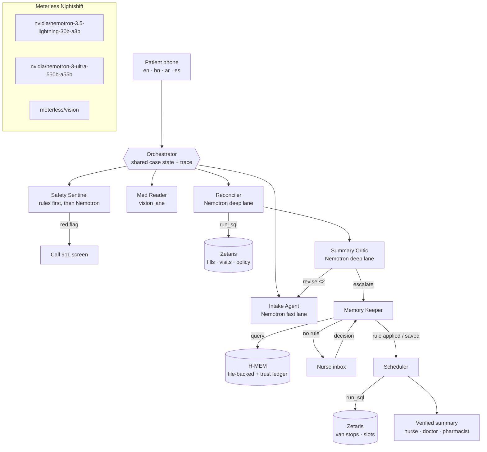

# EchoRx

**Say it once. Every caregiver hears it.**

EchoRx is a multi-agent care-intake system for Detroit's mobile medical vans. A patient tells their story once, on their phone and in their own language, before the van arrives. A team of agents then checks it against pharmacy and visit records in **Zetaris**, has a critic look for gaps, escalates anything uncertain to a nurse, **remembers the nurse's decision with Meterless H-MEM**, and books a van stop the patient can walk to. Every model call goes through **Meterless Nightshift** to **NVIDIA Nemotron**.

> Open Agent Hackathon 2026 · **Track 3: Reasoning Architecture** · built during the build window.
> All data is synthetic. EchoRx never diagnoses, suggests treatment or judges a dose.

---

## The problem

Razia is 72, speaks Bengali, has no car and takes five medicines. At every visit she retells her story to the trainee, the nurse, the doctor and the pharmacist, and each retelling loses detail, especially about medicines. Her bottle at home says metformin **500 mg**. Her pharmacy filled **1000 mg** after her last visit raised the dose. Nobody lines those records up before she arrives.

## What EchoRx does

1. **Intake Agent** asks one question at a time in English, বাংলা, العربية or Español, and reads pill-bottle photos.
2. **Safety Sentinel** checks every message for red flags **before any model runs** ("Call 911 now").
3. **Reconciler** lines up her answers and photos with Zetaris pharmacy fills and visits. Every finding must cite record IDs, or it's rejected.
4. **Summary Critic** looks for gaps and unsupported claims, sends questions back to the patient (max 2 rounds), or escalates.
5. **Memory Keeper** checks **H-MEM** for a nurse rule. If one matches, it applies it and cites the nurse and case. If not, it escalates to the nurse and saves her decision as a new rule.
6. **Scheduler** queries Zetaris for van stops and slots, and picks one within walking distance with a crew that speaks her language.
7. The nurse verifies one summary that **every caregiver** (nurse, doctor, pharmacist) sees.

## Architecture



| Agent | Lane / tool | Job | Talks to |
|---|---|---|---|
| Intake | fast (Nemotron Lightning) | One question at a time, 4 languages, English claims | Sentinel, Critic (follow-ups) |
| Safety Sentinel | rules + fast | Red flags before any model call; model double-check | Orchestrator (911 branch) |
| Med Reader | vision | Reads pill bottles; strips identifiers | Reconciler |
| Reconciler | deep (Nemotron Ultra) + `run_sql` | Dose mismatches, overdue refills, unrecorded meds; evidence-checked | Critic |
| Summary Critic | deep + rules | Approve / revise (ask patient) / escalate; policy can override the model | Intake, Memory Keeper |
| Memory Keeper | H-MEM + fast | Recall nurse rules; turn decisions into general rules | Nurse, Scheduler |
| Scheduler | fast + `run_sql` | Walkable stop, crew language, earliest slot | Patient, Nurse |

Full details: [docs/ARCHITECTURE.md](docs/ARCHITECTURE.md) · Sponsor technology: [docs/SPONSOR_TECH.md](docs/SPONSOR_TECH.md)

---

## Quick start: sample mode (no credentials, 3 commands)

Needs **Node.js 20.10+**.

```bash
npm install
npm run demo
# open http://localhost:8787/demo and press ▶ Play demo
```

With no `.env` file, EchoRx starts in **sample mode**: Zetaris queries are answered from `data/*.json`, and agents use scripted responses. The orchestrator, critic loop, H-MEM memory, scheduling and UI all run for real. The trace labels sample responses as `sample · <model>`.

## Full setup: live mode (Zetaris + Nightshift + Nemotron)

### 1. Zetaris (data layer)
1. Install Zetaris locally in Docker (Participant Setup Guide, Data 1.1–1.7), sign in at `http://localhost:3000`, and create an **API key**.
2. Push this repo to **public** GitHub, so the Zetaris server can download `data/*.json`.
3. Copy `.env.example` to `.env` and set `ZETARIS_API_KEY` and `DATA_BASE_URL` (for example `https://raw.githubusercontent.com/<you>/echorx/main/data`).
4. Register the data:
   ```bash
   npm run zetaris:sql        # builds zetaris/register.sql from the template
   npm run zetaris:register   # runs it one statement at a time, then checks row counts
   ```
   You can also paste `zetaris/register.sql` into the Zetaris SQL Editor one statement at a time.

### 2. Nightshift + NVIDIA (power)
1. Install and run **Nightshift**. Under **Setup → Providers → NVIDIA**, paste your NVIDIA key (it goes there, not in this project).
2. In **NIGHT → LANES**, add `nvidia/nemotron-3.5-lightning-30b-a3b` and `nvidia/nemotron-3-ultra-550b-a55b`.
3. From **Console**, copy the Runtime URL and token into `.env` (`METERLESS_BASE_URL`, `METERLESS_RUNTIME_TOKEN`). Set `SAMPLE_MODE=false`.

### 3. Check every layer
```bash
npm run check
```
```
PASS Data: Zetaris runs SQL over REST
PASS Data: echorx.patients has rows  ·  8 rows
...
PASS Power: Nightshift /v1/models  ·  52 models, 9 Nemotron
PASS Power: fast lane replies  ·  answered by nvidia/nemotron-3.5-lightning-30b-a3b · Nemotron ✓
PASS Power: deep lane replies  ·  answered by nvidia/nemotron-3-ultra-550b-a55b · Nemotron ✓
PASS Build: H-MEM conformance suite  ·  13/13 checks passed
```

### 4. Run
```bash
npm run demo      # build + serve on http://localhost:8787
npm run dev       # development: rebuilds the web app and restarts the server on change
```

> **Windows:** every command above works in PowerShell, with no bash needed. If `npm run zetaris:register` can't reach Zetaris, run it from the same machine as Docker Desktop.

## Using it

| Page | What it shows |
|---|---|
| `/demo` | **Play demo**: Razia (Bengali) → nurse decides → Hassan (Arabic) resolved from memory → Lucía (Spanish) red flag → verified. Built for the video. |
| `/start` | Patient phone: language, consent, chat, pill-bottle photos (3 sample bottles or your own), "Send to my care team" |
| `/nurse` | Inbox: escalations with evidence (patient vs Zetaris records), Decide / Save as rule / Ask patient, auto-resolved items with the H-MEM citation and "Mark wrong" |
| `/case/:id` | Agent trace: every step with agent, model badge (Nemotron in green), lane, latency, SQL and row counts, H-MEM hits, critic verdicts, policy overrides |
| `/doctor` | Only nurse-verified summaries, with reconciled medicines and the booking |
| `/memory` | H-MEM rules with source, confidence and the trust ledger |

## Tests

```bash
npm test           # 34 tests: safety (4 languages + negation), reconciler, orchestrator, H-MEM feature, live-mode contracts
npm run test:hmem  # official Meterless H-MEM conformance suite → docs/hmem-conformance.txt
```

`tests/live-mode.test.ts` runs the full live code path against mock Zetaris and Nightshift servers that enforce the real contracts: Bearer + `X-Org-ID` + UUID `X-Request-ID`, one statement per request, `meterless-app` and `meterless-scope` headers, and a 404 → `meterless/auto` fallback. It also proves that a model-invented finding is rejected and that the critic cannot approve away a nurse item.

## Data

Six small synthetic tables in [`data/`](data/README.md), registered in Zetaris as REST tables plus SchemaStore views: `patients`, `pharmacy_fills`, `visit_history`, `van_stops`, `clinic_slots` and `triage_policy`. Every query an agent runs is listed in [`zetaris/queries.md`](zetaris/queries.md).

## Safety and limitations

- **No diagnosis, treatment or dose judgement.** Prompts forbid it, the Summary Critic checks for it, and a test asserts it.
- Red flags are caught by deterministic rules in 4 languages, with negation handling, before any model call.
- Identifiers are stripped from photos, and images are not stored. Patient text is treated as data, not instructions.
- This is a prototype on synthetic data. It is not a clinical system and has not been validated with clinicians.
- Sample-mode translations of free-typed answers are not automatic. Use the quick replies, or live mode.
- Bengali and Arabic text was written for the demo and should be reviewed by native speakers before real use.
- Vision lane: Med Reader is built to read bottle photos through Nightshift’s vision lane (configured for Nemotron 3.5 Super VL via OpenRouter). The hackathon edition of meterlessd has no Vision duty yet, so image requests return “no configured vision-capable model admits them”. EchoRx detects this, says so in the trace, and uses the known text of its synthetic sample labels. The patient’s spoken medicine list is always checked against the records either way. Once Nightshift supports a vision lane, set MODEL_VISION and it works with no code change.

## Project structure

```
server/        Node HTTP server, agents, providers (Nightshift), data (Zetaris), hmem (H-MEM)
web/           React app (bundled with esbuild)
data/          synthetic data served to Zetaris
zetaris/       registration SQL template, view columns, query catalogue
scripts/       dev, build, check-setup, zetaris register, test runners
tests/         node:test suites, mock services, vendored H-MEM conformance suite
docs/          SPEC, ARCHITECTURE, SPONSOR_TECH, DEMO_SCRIPT, hmem-conformance.txt
```

## Pre-existing components

None of EchoRx's own code existed before the build window. These open-source components are reused: the Meterless H-MEM reference implementation and conformance suite (Apache-2.0, see [NOTICE](NOTICE)), React and zod.

## License

MIT for EchoRx. Apache-2.0 for the vendored H-MEM files. Synthetic data is CC0.
